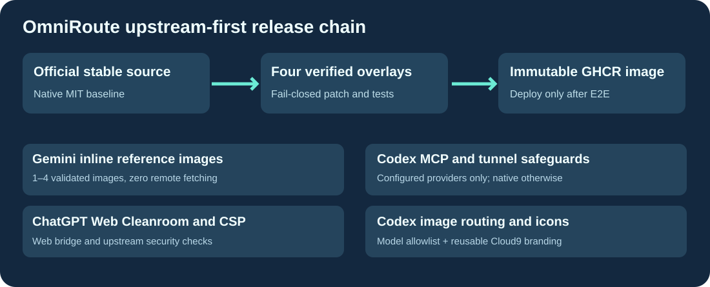

# Cloud9-OmniRoute

**Dernière version stable officielle [OmniRoute](https://github.com/cheaper-inference/OmniRoute) avec des améliorations génériques et une image GHCR construite par GitHub.**

[English](README.md) · Français · [简体中文](README.zh-CN.md)

L'application officielle reste la base de chaque mise à jour. Correctifs conservés après comparaison A/B avec la release officielle : passerelle CSP Cleanroom, 1 à 4 images de référence Gemini sans fetch d'URL distantes, images dédiées Codex, packaging du MCP Codex standalone et protection de son verrou PID. Le correctif optionnel des réponses d'outils strictes a été retiré : désactivé et inutilisé en production.

La CI refuse tout changement upstream non reconnu. Elle publie des candidats immuables, sans basculer la production ni pousser latest avant les tests de routage, authentification, images, Cleanroom, données et rollback.

Aucun secret, cookie, identifiant personnel ou domaine privé n'est inclus. Configuration spécifique à chaque utilisateur dans ses volumes et variables privés. Licence MIT.
