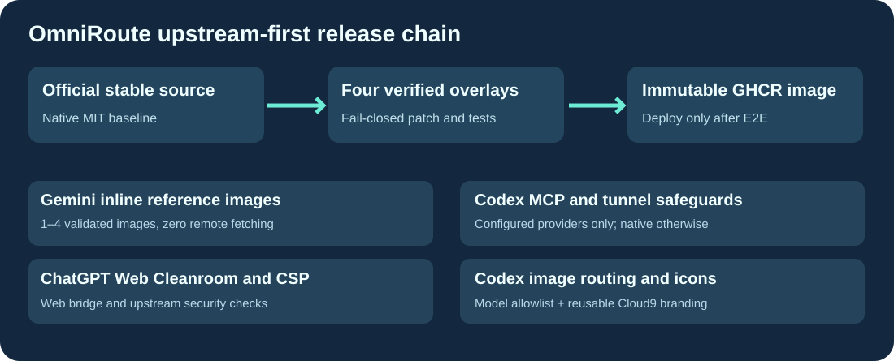

# Cloud9-OmniRoute

**Dernière version stable officielle [OmniRoute](https://github.com/cheaper-inference/OmniRoute) avec des améliorations génériques et une image GHCR construite par GitHub.**

[English](README.md) · Français · [简体中文](README.zh-CN.md)

L'application officielle reste la base de chaque mise à jour. Seuls les correctifs encore nécessaires sont appliqués : compatibilité **Cleanroom / ChatGPT Web CSP** ; **1 à 4 images de référence Gemini** sans fetch d'URL distantes ; normalisation des résultats d'outils uniquement pour les fournisseurs OpenAI compatibles identifiés dans OMNIROUTE_STRICT_TOOL_RESPONSE_PROVIDERS ; prise en charge des modèles d'images **Codex** sans affaiblir OAuth/quotas ; branding **Cloud9 Engine et Speaches**.

Le routage avec affinité de contexte comptabilise chaque essai épinglé en échec une seule fois, conserve les comptes de secours et applique le délai global pendant la lecture et la validation de la réponse.

**Conservation des fonctionnalités :** aucune capacité, intégration ou correction optionnelle ne doit être supprimée au seul motif qu’elle n’est pas utilisée, qu’un abonnement est inactif ou que son activation est désactivée. Elle reste disponible et configurable. Suppression uniquement après accord explicite et test de remplacement.

La CI refuse tout changement upstream non reconnu. Elle publie des candidats immuables, sans basculer la production ni pousser latest avant les tests de routage, authentification, images, Cleanroom, données et rollback.

Aucun secret, cookie, identifiant personnel ou domaine privé n'est inclus. Configuration spécifique à chaque utilisateur dans ses volumes et variables privés. Licence MIT.
