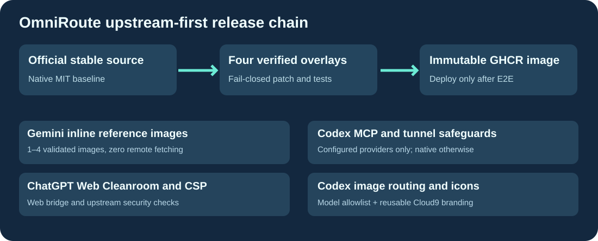

# Cloud9-OmniRoute

**Official [OmniRoute](https://github.com/cheaper-inference/OmniRoute) stable releases with small, reusable, version-aware enhancements.** Images are built on GitHub, not the production server.

English · [Français](README.fr.md) · [简体中文](README.zh-CN.md)

## What Cloud9 adds

| Enhancement | Difference from official upstream |
|---|---|
| Cleanroom and ChatGPT Web CSP | Compatible browser module bridge without bypassing upstream security |
| Gemini inline images | One to four validated JPEG/PNG/WebP reference images, with no remote URL fetching |
| Codex image inventory | Support dedicated image models while retaining OAuth and quotas |
| Codex MCP standalone | Package the upstream MCP server absent from the official runner-web image |
| Codex supervisor lease | Reject stale PID reuse after container restarts without weakening the tunnel lock |
| Cloud9 UI | Cloud9 Engine and Speaches icon assets |

The source overlay checks official TypeScript anchors and fails closed on incompatible upstream changes. The previously optional strict-provider tool-response shim was removed after A/B testing: it was disabled and unused in production.

GitHub Actions downloads the latest official **stable tag**, applies the Cleanroom patch and maintained TypeScript adapters, tests them, builds official runner-web, and publishes an immutable GHCR candidate. The candidate never automatically becomes latest or updates production before authenticated providers, models, Cleanroom, persistent data and rollback are verified.

The public repository and image contain no personal URLs, passwords, OAuth cookies, account identifiers or tokens; those remain in the user's private configuration and volumes.

MIT license, as with the upstream project. Independent distribution, not an official OmniRoute release.
