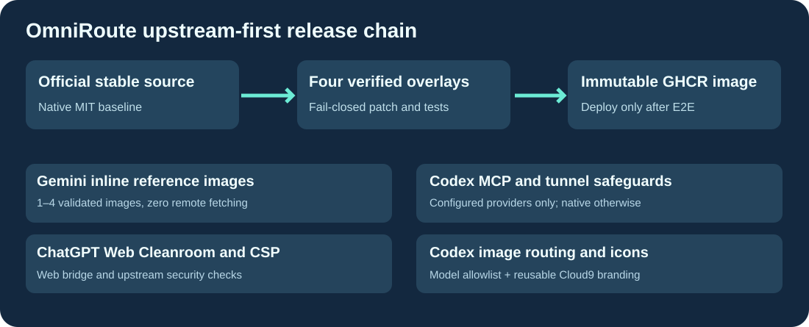

# Cloud9-OmniRoute

**官方 [OmniRoute](https://github.com/cheaper-inference/OmniRoute) 最新稳定版，附带通用兼容性增强，由 GitHub 构建 GHCR 镜像。**

[English](README.md) · [Français](README.fr.md) · 简体中文

每次都以官方最新稳定版本为基础。经过与官方纯净版的 A/B 比较，保留必要补丁：Cleanroom CSP 浏览器桥接；1 至 4 张内嵌 Gemini 参考图并拒绝远程 URL；Codex 专用图像模型；单体 Docker 镜像内的 Codex MCP 服务端；重启后防止 PID 复用导致的隧道锁冲突。此前未启用、未被生产使用的严格工具响应补丁已删除。

GitHub Actions 检查补丁、功能及正式构建，发布不可变候选镜像。未经模型、OAuth、图片、Cleanroom、数据及回滚测试，不自动发布 latest 或部署生产环境。

仓库与镜像无个人信息、API 密钥、Cookie、私有域名或用户数据。特定配置保存在私有环境中。MIT 许可证。
